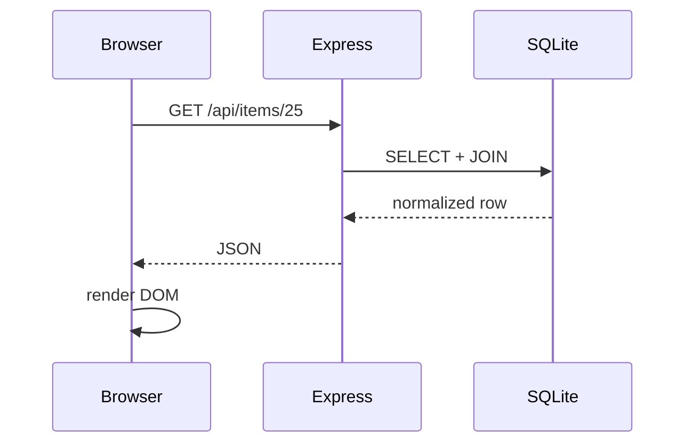

# API reference

## Public endpoints

| Method | Route | Purpose |
|---|---|---|
| GET | `/api/items` | catalogue |
| GET | `/api/items/:id` | one item |
| GET | `/api/filters` | filter/reference values |
| POST | `/api/auth/login` | create session |
| GET | `/api/auth/session` | check session |
| POST | `/api/auth/logout` | end session |

## Protected administration

All `/api/admin/*` routes require an authenticated session. Typical resource groups are items, categories, colours, sizes, boxes and photos.

