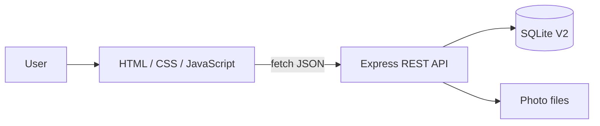

# Architecture

## Main architecture



The browser never accesses SQLite directly. Every data operation goes through Express.

## Technology choices

| Layer | Technology | Reason |
|---|---|---|
| Frontend | HTML/CSS/plain JavaScript | enough for requirements; easy to explain |
| Backend | Node.js + Express | lightweight REST API + static files |
| Database | SQLite | reliable, transactional, file-based |
| SQLite library | `better-sqlite3` | simple synchronous API |
| Uploads | `multer` | multipart upload support |
| Excel import | `xlsx` | reads the original workbook |
| Desktop | Electron | reuses the web application |
| Installer | electron-builder + NSIS | produces a Windows installer |

## Runtime storage abstraction

Representative pattern:

```js
const dbPath =
    process.env.DATABASE_PATH ||
    path.join(__dirname, "database", "inventory.db");
```

The same backend therefore works with different writable storage:

```text
Local:    database/inventory.db
Railway:  /data/inventory.db
Desktop:  userData/inventory.db
```

The same idea is used for uploaded images through `IMAGES_DIRECTORY`.

## Design principle

```text
one frontend + one backend + one data model = three deployment modes
```

This reduces duplicated logic and keeps behaviour consistent.
