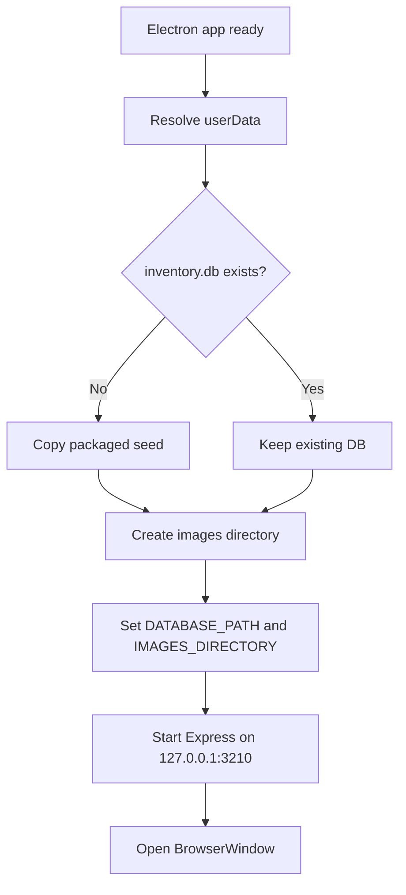

# Code walkthrough

This page is designed for questions such as **“show me where the code does that.”**

## `server.js`

### Runtime paths

The backend uses environment-aware paths:

```js
const dbPath =
    process.env.DATABASE_PATH ||
    path.join(__dirname, "database", "inventory.db");
```

This is what lets the same backend run locally, on Railway and inside Electron.

### Public API

```text
GET /api/items
GET /api/items/:id
GET /api/filters
```

Queries join normalized tables so the frontend receives readable category/colour/size/box values.

### Admin security

Conceptually:

```text
/api/admin/* → requireAdminAuthentication → CRUD handler
```

The backend, not only the page redirect, enforces access control.

### Photo handling

Uploaded files are written to the configured images directory. The database stores metadata/relative paths, while the physical file lives in writable storage.

---

## `database/schema.sql`

Important relationships:

```text
items.category_id → categories.id
items.colour_id   → colours.id
items.box_id      → boxes.id
items.photo_id    → photos.id
```

Reference tables use `ON DELETE RESTRICT`; photos use `ON DELETE SET NULL`.

---

## `scripts/init-db.js`

Sequence:

1. resolve database path;
2. ensure parent folder exists;
3. enable foreign keys;
4. inspect existing structure;
5. reject incompatible V1/hybrid DBs;
6. apply schema;
7. validate required tables;
8. run foreign-key check;
9. close DB.

---

## `scripts/import-excel.js`


Important safeguards:

- skips rows marked deleted;
- preserves missing quantity as `NULL`;
- rejects invalid numeric values instead of silently truncating;
- imports in a transaction;
- refuses accidental normal import into a non-empty V2 DB unless replace mode is explicitly used.

---

## `public/js/search.js`

Size checks both fields:

```js
itemFields: ["size_primary", "size_secondary"]
```

Filter rule:

```text
OR inside one group
AND between groups
```

Facet counts temporarily ignore the facet being counted, while keeping text search and all other selected groups.

`sessionStorage` preserves search text, selected values, open filter groups and scroll positions.

---

## `public/js/item.js`

Responsibilities:

- parse and validate `id`;
- request `/api/items/:id`;
- render details safely;
- use image fallback;
- distinguish invalid ID, 404 and server error.

---

## `public/js/login.js`

Sends credentials to:

```text
POST /api/auth/login
```

Credentials are not stored in this JavaScript file.

---

## `public/js/admin.js`

Controls:

- session verification;
- item table/search/pagination;
- add/edit/delete;
- confirmation modal;
- reference data;
- photo upload/replace/remove;
- status banners.

---

## `desktop/main.js`



The installed application never treats its installation directory as writable user data.

---

## `package.json`

Important scripts:

```text
start             local web server
check             syntax validation
desktop           Electron development run
desktop:rebuild   rebuild native modules for Electron
desktop:dist      Windows NSIS installer
```
