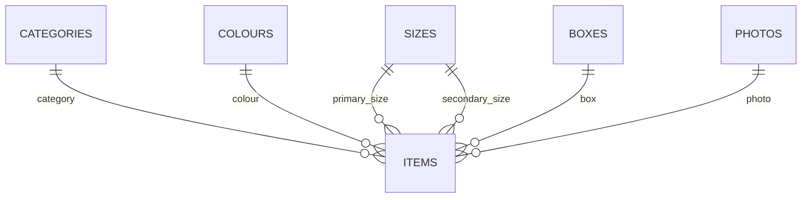

# Database V2



## Tables

`categories`, `colours`, `sizes`, `boxes`, `photos`, `items`.

## Why normalization matters

V1 repeated text in every item. V2 stores canonical references, which improves consistency, integrity and safe editing.

## Quantity semantics

```text
0    = known quantity is zero
NULL = the source did not specify a quantity
```

The final database contains **11 legitimate `NULL` quantities**, verified against the source Excel.

## Validated counts

| Table | Count |
|---|---:|
| items | 1017 |
| categories | 5 |
| colours | 102 |
| sizes | 53 |
| boxes | 74 |
| photos | 242 |

## Integrity checks

```sql
PRAGMA foreign_key_check;
PRAGMA integrity_check;
```

Expected:

```text
[]
ok
```
