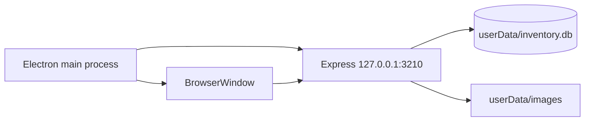

# Windows desktop

Electron is not a rewrite. It starts the same Express application and opens it inside a `BrowserWindow`.



## Why bind to `127.0.0.1`

Only the local Electron window needs the embedded API. Loopback binding avoids unnecessary LAN exposure and avoids a Windows Firewall prompt in normal operation.

## Writable data location

Typical path:

```text
C:\Users\<user>\AppData\Roaming\theatre-costume-search
```

Contains:

```text
inventory.db
images/
```

## First run

If `inventory.db` does not yet exist in `userData`, Electron copies the packaged V2 seed database there. Existing user data is preserved on later runs.
