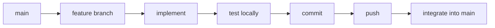

# Development workflow



## Start clean

```bash
git checkout main
git pull origin main
git status
```

## Create a feature branch

```bash
git checkout -b feature/example-change
```

## Validate the change

```bash
npm run check
git diff --check
git status --short
```

Manually test the behaviour that changed.

## Stage and inspect

```bash
git add -A
git diff --cached --check
git diff --cached --stat
git diff --cached --name-status
```

## Commit and push

```bash
git commit -m "Describe the change"
git push -u origin feature/example-change
```

## Integrate into main

```bash
git checkout main
git pull origin main
git merge --ff-only feature/example-change
git push origin main
```

`--ff-only` is useful because it refuses an unexpected merge when histories diverge.
