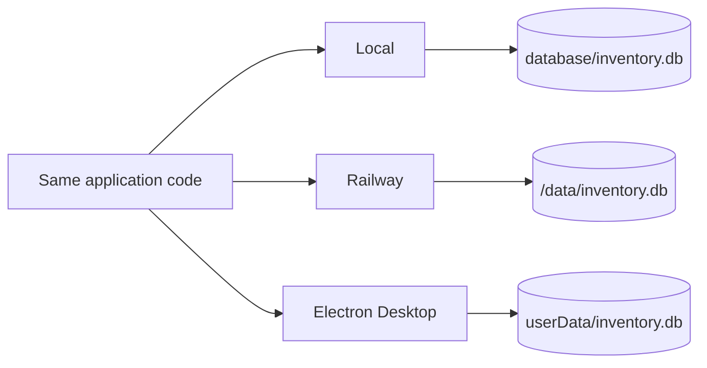

# Start here

## Project in one minute

**Theatre Costume Search** transforms a theatre inventory originally stored in Excel into a searchable, maintainable application.

The final system provides a public catalogue, ranked text search, faceted filters, item details, photographs, an authenticated Database Editor, CRUD, reference-data management, photo management, Railway production and a Windows Electron application.

## Three execution modes

| Mode | Purpose | Database | Uploaded photos |
|---|---|---|---|
| Local | Development/testing | `database/inventory.db` | `public/images/` by default |
| Railway | Public production | `/data/inventory.db` | `/data/images/` |
| Desktop | Installed Windows app | `userData/inventory.db` | `userData/images/` |

## Study route for the defence

1. Project history
2. Architecture
3. Project structure
4. Code walkthrough
5. Database V2
6. Search & filters
7. Admin, photos & security
8. Complete release workflow
9. Defence guide
10. Cheat sheet

!!! success "Key sentence"
    “The same Express/SQLite application is reused in local, production and desktop environments. The main differences are hosting and writable storage paths.”
