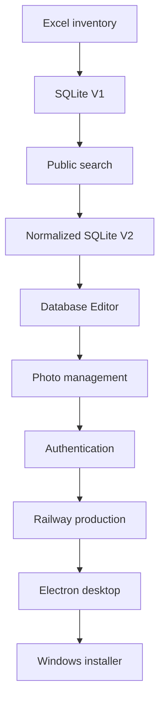

# Project history

## Starting point

The theatre inventory existed in Excel. Excel was useful as a source of structured data, but inconvenient for fast searching, controlled editing, relationships and remote access.

## Evolution

## Why V2 was necessary

V1 stored repeated textual values directly in `items`. That was enough for an early prototype, but a robust editor needed canonical values, foreign keys and safe deletion rules.

V2 therefore normalized categories, colours, sizes, boxes and photos.

## Engineering problems solved during the project

- importing imperfect real Excel data;
- preserving unknown quantities as `NULL`;
- normalizing reference data;
- safely deleting referenced values;
- matching both primary and secondary sizes;
- keeping uploads persistent on Railway;
- adding backend-enforced authentication;
- rebuilding `better-sqlite3` for Electron;
- moving Desktop data to writable `userData`;
- seeding a new Desktop installation;
- binding Desktop Express to `127.0.0.1`.

!!! note
    The project history is evidence of iterative problem solving: each major change solved a limitation discovered in the previous version.
