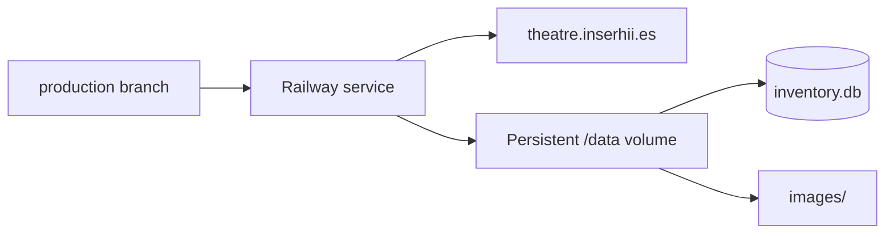

# Railway production

Production URL:

```text
https://theatre.inserhii.es
```

Persistent mount:

```text
/data
```



## Runtime variables

```text
DATABASE_PATH=/data/inventory.db
IMAGES_DIRECTORY=/data/images
ADMIN_USERNAME=<secret>
ADMIN_PASSWORD=<secret>
```

Railway supplies `PORT`.

## Why persistence matters

A deployment can replace application files, but `/data` survives. Therefore mutable production data belongs on the volume.

## V1 → V2 production migration

The validated procedure was:

1. download the V1 DB;
2. inspect the old structure;
3. compare V1 and local V2 counts;
4. confirm 1017 items and 242 photo rows;
5. run SQLite integrity checks;
6. upload V2 under a temporary name;
7. rename V1 as backup;
8. promote V2 to `/inventory.db`;
9. deploy V2 code;
10. test CRUD and photo upload;
11. redeploy;
12. verify the uploaded photo still exists.

Remote backup:

```text
/data/inventory-v1-before-v2.db
```
