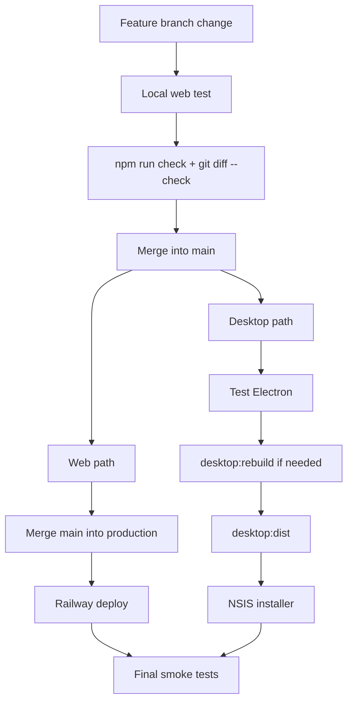

# Complete release workflow

This page explains how one code change reaches local, web production and Desktop.



## Example: changing `public/js/search.js`

### Local

```bash
git checkout -b feature/search-improvement
# edit search.js
npm run check
npm start
```

### Integrate into main

```bash
git add public/js/search.js
git commit -m "Improve search behaviour"
git push -u origin feature/search-improvement

git checkout main
git pull origin main
git merge --ff-only feature/search-improvement
git push origin main
```

### Web production

```bash
git checkout production
git pull origin production
git merge main
npm run check
git push origin production
```

Railway deploys the new web code.

### Desktop

Because Electron reuses `public/` and `server.js`, the same change is already present when Desktop is built from updated `main`.

```bash
npm run desktop
npm run desktop:dist
```

Run `desktop:rebuild` if Electron/native dependencies changed.

!!! success "Defence answer"
    Web and Desktop are two deployment targets of the same application, so most functional changes are implemented once and then validated in both runtimes.
