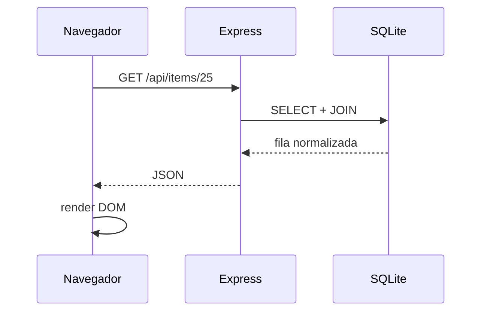

# Referencia API

## Pública

| Método | Ruta | Función |
|---|---|---|
| GET | `/api/items` | catálogo |
| GET | `/api/items/:id` | un item |
| GET | `/api/filters` | filtros/referencias |
| POST | `/api/auth/login` | login |
| GET | `/api/auth/session` | comprobar sesión |
| POST | `/api/auth/logout` | cerrar sesión |

## Administración protegida

Todo `/api/admin/*` requiere autenticación. Los grupos principales incluyen items, categorías, colores, tallas, cajas y fotos.

