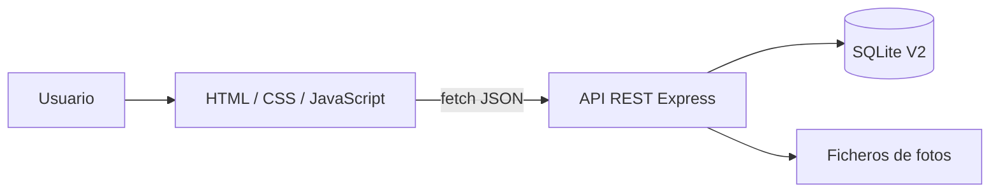

# Arquitectura



El navegador nunca accede directamente a SQLite.

## Tecnologías

| Capa | Tecnología | Motivo |
|---|---|---|
| Frontend | HTML/CSS/JS | suficiente y fácil de defender |
| Backend | Node.js + Express | API REST ligera |
| DB | SQLite | fiable, transaccional, sin servidor aparte |
| SQLite | `better-sqlite3` | API sencilla |
| Upload | `multer` | multipart |
| Excel | `xlsx` | lectura del origen |
| Desktop | Electron | reutiliza la web |
| Instalador | electron-builder + NSIS | Setup Windows |

## Rutas según entorno

Patrón representativo:

```js
const dbPath =
    process.env.DATABASE_PATH ||
    path.join(__dirname, "database", "inventory.db");
```

```text
Local:    database/inventory.db
Railway:  /data/inventory.db
Desktop:  userData/inventory.db
```

La misma idea se usa para `IMAGES_DIRECTORY`.
