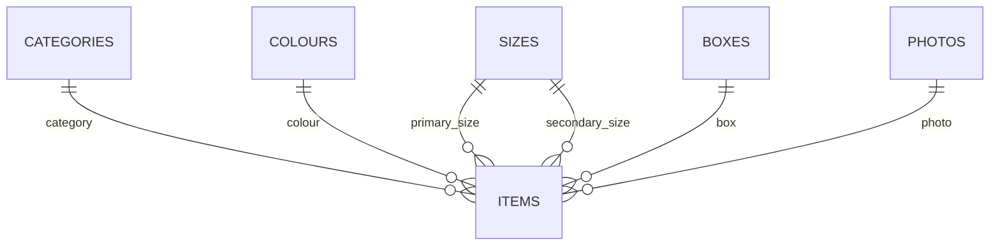

# Base de datos V2



## Tablas

`categories`, `colours`, `sizes`, `boxes`, `photos`, `items`.

## Por qué normalizar

V1 repetía textos en cada item. V2 usa referencias canónicas para mejorar consistencia, integridad y edición segura.

## Semántica de cantidad

```text
0    = sabemos que la cantidad es cero
NULL = el origen no especificó cantidad
```

Hay **11 `NULL` legítimos**, verificados con el Excel original.

## Conteos finales

| Tabla | Registros |
|---|---:|
| items | 1017 |
| categories | 5 |
| colours | 102 |
| sizes | 53 |
| boxes | 74 |
| photos | 242 |

## Integridad

```sql
PRAGMA foreign_key_check;
PRAGMA integrity_check;
```

Resultado esperado:

```text
[]
ok
```
