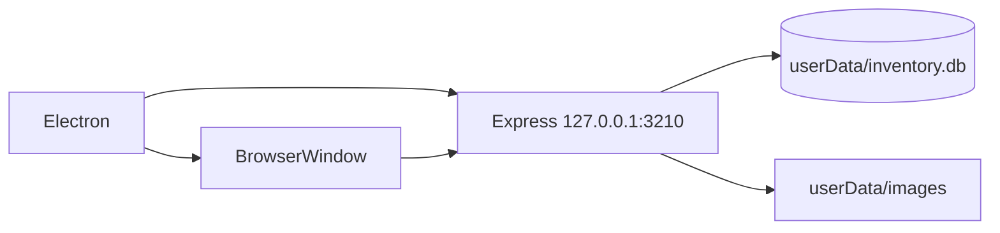

# Escritorio Windows

Electron no reescribe el proyecto: arranca la misma aplicación Express y la muestra dentro de `BrowserWindow`.



## Por qué `127.0.0.1`

La API embebida solo la necesita la ventana local. Esto evita exposición innecesaria a la LAN y evita el aviso de Firewall en uso normal.

## Datos escribibles

Ruta típica:

```text
C:\Users\<usuario>\AppData\Roaming\theatre-costume-search
```

Contenido:

```text
inventory.db
images/
```

## Primer arranque

Si no existe `inventory.db` en `userData`, Electron copia allí la seed V2 empaquetada. En arranques posteriores conserva los datos existentes.
