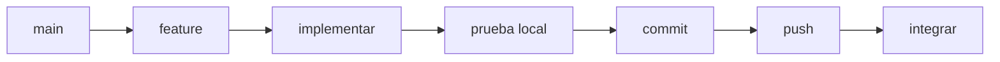

# Flujo de desarrollo



## Empezar limpio

```bash
git checkout main
git pull origin main
git status
```

## Crear rama

```bash
git checkout -b feature/cambio
```

## Validar

```bash
npm run check
git diff --check
git status --short
```

## Stage e inspección

```bash
git add -A
git diff --cached --check
git diff --cached --stat
git diff --cached --name-status
```

## Commit y push

```bash
git commit -m "Descripción clara"
git push -u origin feature/cambio
```

## Integrar

```bash
git checkout main
git pull origin main
git merge --ff-only feature/cambio
git push origin main
```
