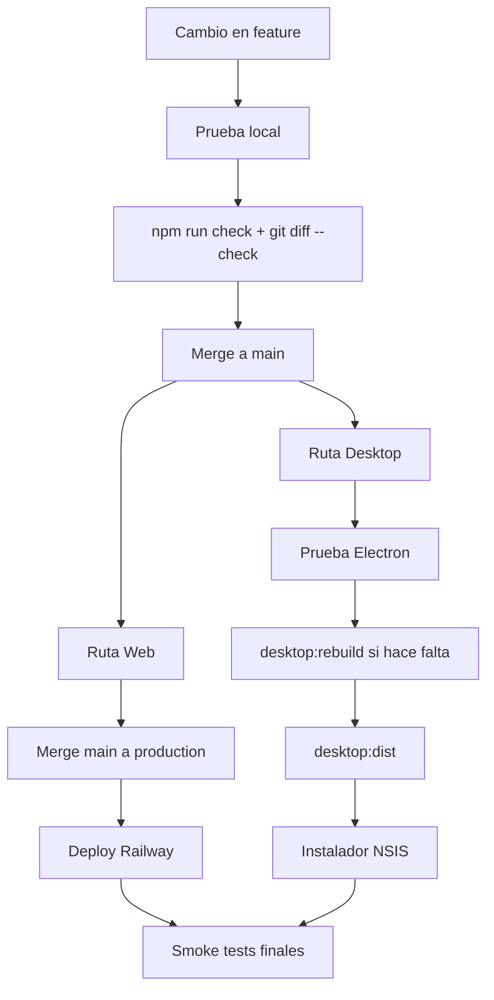

# Flujo completo de release

Esta página explica cómo un solo cambio termina en local, Web y Desktop.



## Ejemplo: cambio en `public/js/search.js`

### Local

```bash
git checkout -b feature/search-improvement
# modificar search.js
npm run check
npm start
```

### Main

```bash
git add public/js/search.js
git commit -m "Improve search behaviour"
git push -u origin feature/search-improvement

git checkout main
git pull origin main
git merge --ff-only feature/search-improvement
git push origin main
```

### Web

```bash
git checkout production
git pull origin production
git merge main
npm run check
git push origin production
```

### Desktop

Electron reutiliza `public/` y `server.js`, así que el mismo cambio ya está presente al construir Desktop desde `main` actualizado.

```bash
npm run desktop
npm run desktop:dist
```

Si cambian dependencias nativas:

```bash
npm run desktop:rebuild
```

!!! success "Idea clave"
    Web y Desktop son dos destinos de despliegue de la misma aplicación, no dos proyectos separados.
