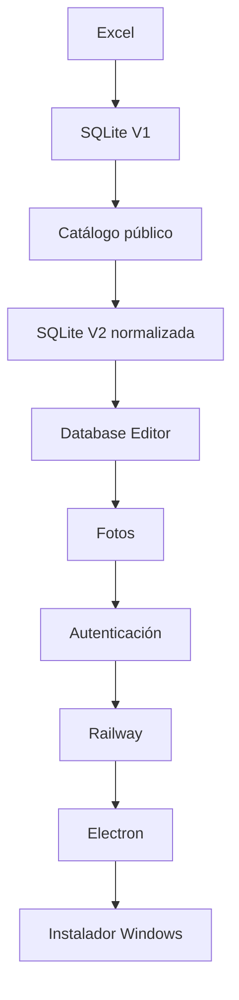

# Historia del proyecto

## Punto de partida

El teatro tenía el inventario en Excel. Era útil como fuente de datos, pero incómodo para búsqueda rápida, relaciones, edición controlada y acceso remoto.

## Evolución

## Por qué V2 fue necesaria

V1 guardaba textos repetidos dentro de `items`. Para un editor robusto hacía falta separar categorías, colores, tallas, cajas y fotos en tablas canónicas con claves foráneas.

## Problemas técnicos resueltos

- importación del Excel real;
- conservación de cantidades desconocidas como `NULL`;
- normalización;
- borrado seguro;
- talla primaria y secundaria;
- fotos persistentes;
- autenticación en backend;
- volumen persistente Railway;
- rebuild de `better-sqlite3` para Electron;
- almacenamiento Desktop en `userData`;
- seed de primer arranque;
- servidor Desktop limitado a `127.0.0.1`.

!!! note
    La historia demuestra desarrollo iterativo: cada fase resolvió una limitación concreta de la anterior.
