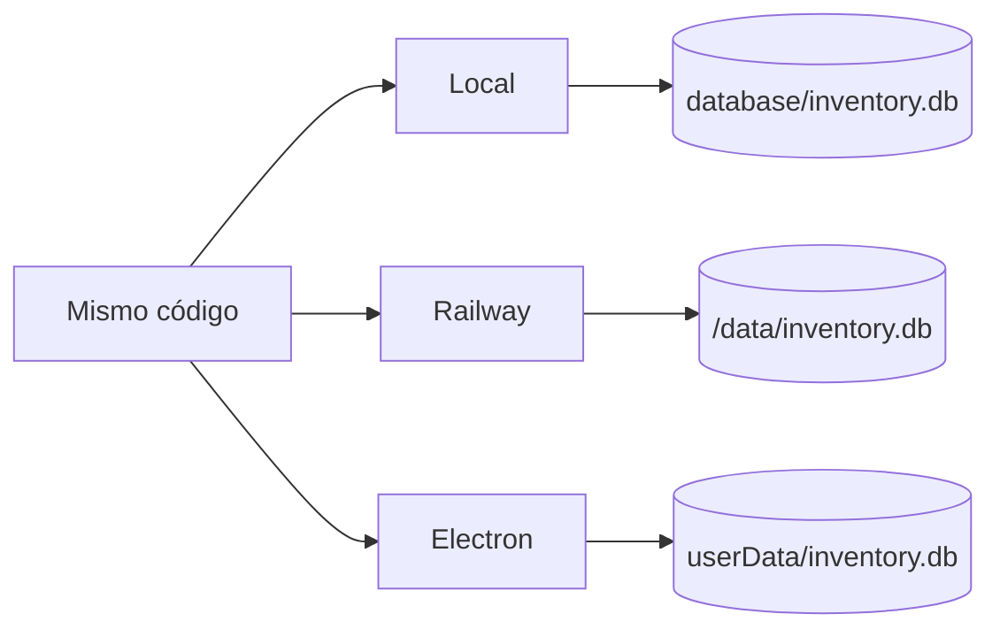

# Empieza aquí

## El proyecto en un minuto

**Theatre Costume Search** transforma un inventario teatral originalmente guardado en Excel en una aplicación buscable, administrable y desplegable.

La solución final incluye catálogo público, búsqueda por relevancia, filtros facetados, fichas de detalle, fotos, Database Editor autenticado, CRUD, referencias, Railway, Electron e instalador Windows.

## Tres modos de ejecución

| Modo | Uso | Base de datos | Fotos nuevas |
|---|---|---|---|
| Local | Desarrollo/pruebas | `database/inventory.db` | `public/images/` |
| Railway | Producción | `/data/inventory.db` | `/data/images/` |
| Desktop | App Windows | `userData/inventory.db` | `userData/images/` |

## Ruta recomendada para la defensa

1. Historia
2. Arquitectura
3. Estructura del proyecto
4. Recorrido del código
5. Base de datos V2
6. Búsqueda y filtros
7. Admin, fotos y seguridad
8. Flujo completo de release
9. Guía de defensa
10. Chuleta

!!! success "Frase clave"
    “La misma aplicación Express/SQLite se reutiliza en local, producción y escritorio; cambian principalmente el hosting y las rutas de almacenamiento escribible.”
