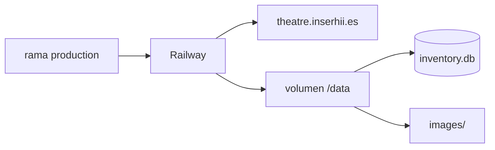

# Producción Railway

URL:

```text
https://theatre.inserhii.es
```

Volumen persistente:

```text
/data
```



## Variables runtime

```text
DATABASE_PATH=/data/inventory.db
IMAGES_DIRECTORY=/data/images
ADMIN_USERNAME=<secreto>
ADMIN_PASSWORD=<secreto>
```

Railway aporta `PORT`.

## Persistencia

El deploy puede sustituir ficheros de la aplicación, pero `/data` sobrevive.

## Migración V1→V2 real

1. descargar backup V1;
2. inspeccionar estructura;
3. comparar V1 y V2;
4. confirmar 1017 items y 242 fotos;
5. integrity checks;
6. subir V2 con nombre temporal;
7. renombrar V1 como backup;
8. promover V2 a `/inventory.db`;
9. desplegar código V2;
10. probar CRUD/fotos;
11. hacer redeploy;
12. comprobar persistencia.

Backup remoto:

```text
/data/inventory-v1-before-v2.db
```
