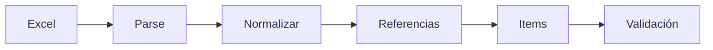
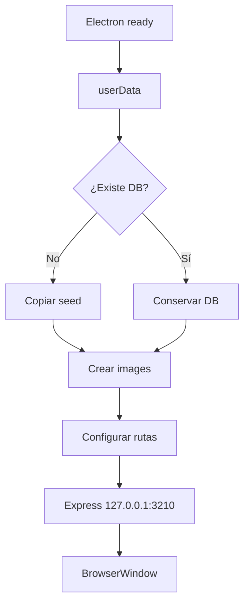

# Recorrido del código

Esta página sirve para preguntas del tipo **“enséñame dónde está implementado.”**

## `server.js`

### Rutas runtime

```js
const dbPath =
    process.env.DATABASE_PATH ||
    path.join(__dirname, "database", "inventory.db");
```

Permite reutilizar el backend en local, Railway y Desktop.

### API pública

```text
GET /api/items
GET /api/items/:id
GET /api/filters
```

### Seguridad admin

```text
/api/admin/* → requireAdminAuthentication → handler CRUD
```

La protección real está en el backend.

### Fotos

Los ficheros físicos van a un directorio escribible configurable; la DB conserva metadatos/rutas relativas.

---

## `database/schema.sql`

```text
items.category_id → categories.id
items.colour_id   → colours.id
items.box_id      → boxes.id
items.photo_id    → photos.id
```

Referencias: `RESTRICT`. Foto: `SET NULL`.

---

## `scripts/init-db.js`

1. resuelve ruta;
2. crea carpeta padre;
3. activa foreign keys;
4. inspecciona DB existente;
5. rechaza estructura incompatible;
6. aplica schema;
7. valida tablas;
8. ejecuta `foreign_key_check`;
9. cierra DB.

---

## `scripts/import-excel.js`



Protecciones: omite filas eliminadas, conserva `NULL`, rechaza numéricos inválidos, usa transacción y evita importar encima de una V2 no vacía salvo modo replace explícito.

---

## `public/js/search.js`

Talla revisa ambos campos:

```js
itemFields: ["size_primary", "size_secondary"]
```

```text
OR dentro de grupo
AND entre grupos
```

`sessionStorage` conserva texto, filtros, grupos abiertos y scroll.

---

## `public/js/item.js`

Valida `id`, pide `/api/items/:id`, renderiza, usa fallback de imagen y distingue errores.

## `public/js/login.js`

Envía credenciales a `POST /api/auth/login`. No contiene la contraseña.

## `public/js/admin.js`

Gestiona sesión, tabla, búsqueda, paginación, modales, CRUD, referencias, fotos y banners.

## `desktop/main.js`



## `package.json`

```text
start
check
desktop
desktop:rebuild
desktop:dist
```
